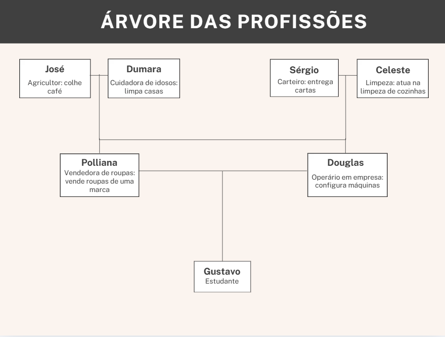

# arvore-das-profissoes

# 🌳 Árvore das Profissões e Impactos da IA

Este repositório reúne o mapeamento das profissões da minha família ao longo de três gerações e uma análise sobre como a tecnologia e a Inteligência Artificial transformaram e ainda vão transformar três dessas áreas de atuação.

---

## 📋 Sobre a Atividade

Esta atividade faz parte da unidade curricular **Mundo do Trabalho (SENAI)** — *Dia 22: Pesquisa com IA*. O objetivo do projeto é:
1. Mapear as ocupações profissionais dos familiares em uma árvore genealógica para compreender a trajetória de trabalho da família.
2. Utilizar a Inteligência Artificial como ferramenta de pesquisa para investigar como três profissões da árvore evoluíram nos últimos 20 anos e quais impactos a IA trará nos próximos 10 anos.
3. Validar as informações em fontes reais e confiáveis, documentando os resultados confirmados em arquivos Markdown (`README.md` e `pesquisa.md`) no GitHub.

---

## 🖼️ Minha Árvore das Profissões

### 🔗 Relação da Árvore com as Profissões Pesquisadas
A imagem acima representa a história profissional de três gerações da minha família, começando pelos meus avós (**José**, **Dumara**, **Sérgio** e **Celeste**), passando pelos meus pais (**Polliana** e **Douglas**) até chegar a mim (**Gustavo**, atualmente estudante). 

Para a pesquisa detalhada sobre o futuro do trabalho, selecionei três profissões presentes na árvore que ilustram diferentes setores da economia:
* **Agricultor (José — avô materno):** Representa o setor primário e o trabalho no campo (colheita de café), área que passou por forte mecanização e hoje incorpora agricultura de precisão e drones.
* **Carteiro (Sérgio — avô paterno):** Representa o setor de serviços e logística (entrega de cartas), profissão que migrou das correspondências físicas para a gestão digital de encomendas do comércio eletrônico.
* **Operador de Máquinas (Douglas — pai):** Representa o setor industrial (configuração de máquinas em empresa), função diretamente impactada pela Indústria 4.0, automação CNC e manutenção preditiva com IA.

---

## 💡 O que eu aprendi

* **A tecnologia transforma, mas não elimina a importância humana:** As profissões da minha família não desapareceram com os avanços tecnológicos, mas exigiram adaptação constante — como o carteiro que trocou o papel por coletores digitais e o operador de máquinas que passou a lidar com painéis automatizados.
* **Uso crítico e responsável da Inteligência Artificial:** Aprendi que a IA é excelente para estruturar pesquisas e levantar cenários futuros, mas toda informação gerada precisa ser checada e confirmada em fontes oficiais (como SENAI, Embrapa e Correios) antes de ser publicada.
* **Documentação e organização no GitHub:** Desenvolvi na prática a estruturação de projetos utilizando linguagem Markdown, organização de repositórios e registro de fontes de pesquisa.

